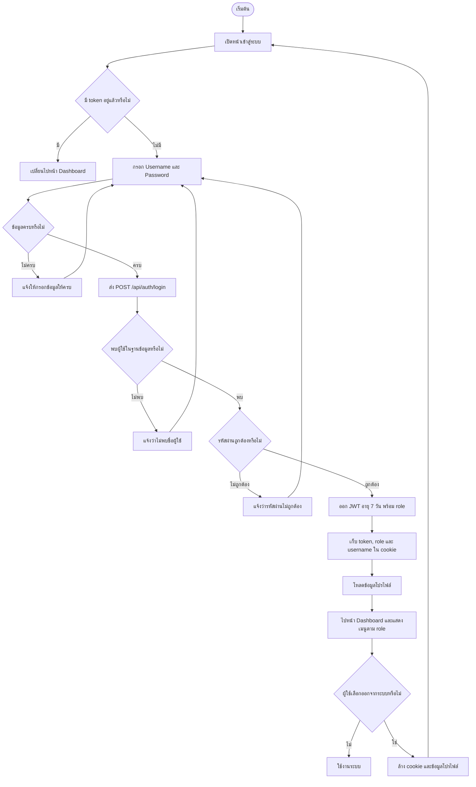
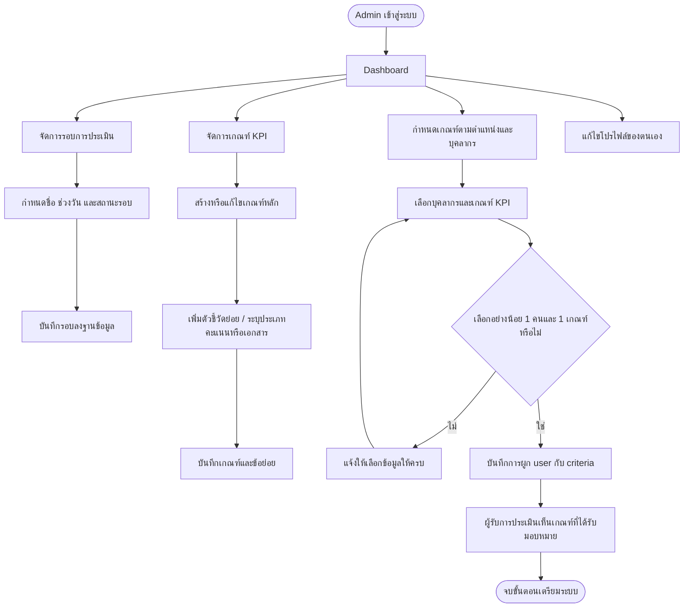
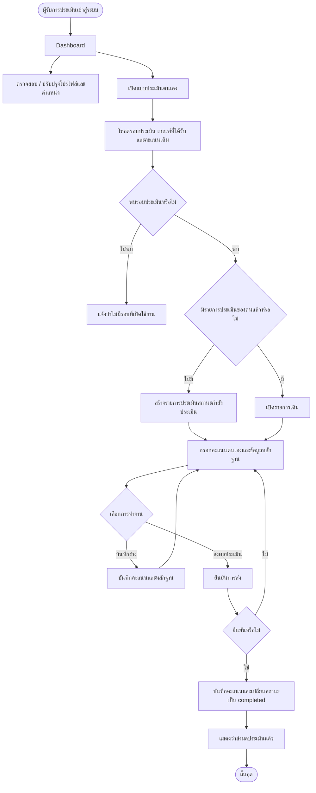
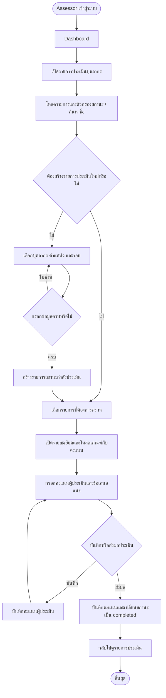
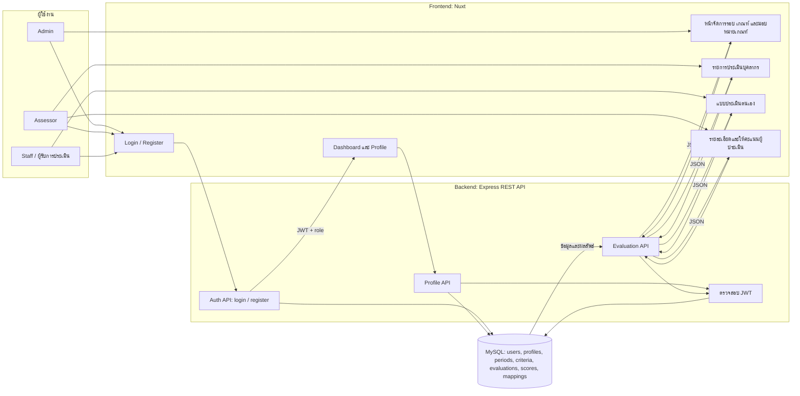
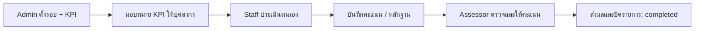

# แผนผังการทำงานระบบประเมินผลบุคลากร

เอกสารนี้สรุป flow จากหน้าเว็บและ API ที่มีอยู่ใน `ccfront-main` และ `ccontest-main`

## 1. แผนผังการเข้าสู่ระบบ (Login Flow)

## 2. กระบวนการของงานบุคลากร / ผู้ดูแลระบบ (Admin)

> หมายเหตุ: ระบบมี role `admin`, `assessor` และ `user` โดยเมนูจัดการรอบ เกณฑ์ และการมอบหมายอยู่ในส่วน Admin

## 3. กระบวนการของผู้รับการประเมิน (Staff / User)

## 4. กระบวนการของกรรมการผู้ประเมิน (Assessor)

## 5. ภาพรวมระบบ (System Flow Overview)

### วงจรข้อมูลการประเมินโดยย่อ

## ขอบเขตที่ควรทราบ

- แผนผังอิงพฤติกรรมที่พบในโค้ดปัจจุบัน: สถานะรายการประเมินเริ่มที่ `in-progress` และการส่งจะเปลี่ยนเป็น `completed`.
- API คะแนน/ประเมินใช้ JWT ตรวจตัวตน แต่ route ที่อ่านและบันทึกคะแนนไม่ได้ตรวจ role หรือความเป็นเจ้าของรายการใน backend; การจำกัดเมนู Admin บางส่วนทำที่ frontend.
- การสมัครสมาชิกมีตัวเลือก role ในหน้าเว็บ รวมถึง `admin` และ `assessor`.
